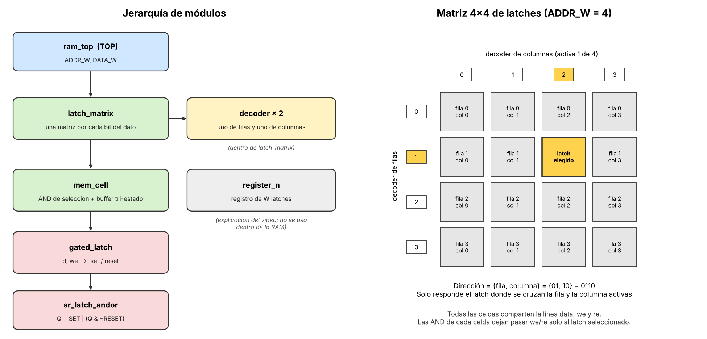
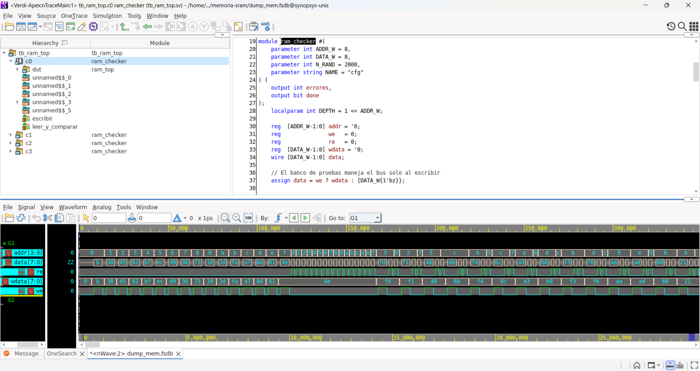

# Memoria RAM estática parametrizada en SystemVerilog

José Rueda, carné 18123. Arquitectura de Computadoras, Universidad del Istmo de Guatemala.

Implementación de la estructura de memoria que se explica en el video
[How Transistors Remember Data](https://www.youtube.com/watch?v=rM9BjciBLmg) (Core Dumped),
como un módulo `top` parametrizable: **`ram_top`**.

Video explicativo: [enlace pendiente]



## Qué hay en cada archivo (todo está en la primera capa)

| Archivo | Qué es | Parte del video |
|---|---|---|
| `sr_latch_andor.sv` | Latch AND-OR: `Q = SET \| (Q & ~RESET)`. El lazo de realimentación recuerda 1 bit | Primero se combinan el circuito OR y el AND y se agrega un inversor |
| `gated_latch.sv` | Latch con entrada de escritura (`we`): con `we=0` ignora el dato, con `we=1` lo guarda | "Gated latch" |
| `register_n.sv` | Registro de `W` bits: `W` latches con el mismo `we` | "Registro" |
| `decoder.sv` | Decodificador: activa una sola de sus `2^N` salidas | Decodificadores de filas y columnas |
| `mem_cell.sv` | Un latch con compuertas AND de selección (fila y columna) y buffer de tres estados sobre la línea `data` | Latch con lectura y escritura por una sola línea |
| `latch_matrix.sv` | Matriz de latches de 1 bit con dos decodificadores | Matriz 4×4 |
| **`ram_top.sv`** | **TOP**: una matriz por cada bit del dato, todas con la misma dirección | "RAM": lista de bytes |
| `tb_ram_top.sv` | Testbench autoverificable de la RAM | |
| `tb_latches.sv` | Testbench de los bloques pequeños | |
| `resultado_simulacion_vcs.log` | Salida de la simulación con VCS (`Errores: 0`) | |
| `01_verdi_escritura_y_lectura.png` | Captura de Verdi: escritura y lectura de la memoria | |

## Parámetros del top

```systemverilog
ram_top #(.ADDR_W(8), .DATA_W(8)) u_ram (.addr(addr), .we(we), .re(re), .data(data));
```

- `ADDR_W`: ancho del bus de direcciones. Hay `2^ADDR_W` posiciones. Con `ADDR_W = 8` son 256 posiciones y dos decodificadores de 16 salidas, como en el video. El ancho se reparte entre filas (`ADDR_W/2`) y columnas (el resto).
- `DATA_W`: ancho de cada dato. Con 8 es un byte, como en el video.

Puertos: `addr` (dirección), `we` (escribir), `re` (leer) y `data`, un bus **bidireccional**: la RAM solo lo maneja al leer.

## Cómo se usa

- **Escribir:** poner `addr` y el dato en `data`, y luego subir `we`.
- **Leer:** poner `addr` y subir `re`; el dato aparece en `data`.
- `we` y `re` no deben estar activas a la vez. Si lo están, gana la escritura y la RAM no maneja el bus.
- La memoria es **asíncrona** (sin reloj), como la del video. Es memoria estática (SRAM).
- Una posición que nunca se escribió vale `X` en simulación.

## Cómo simular

Con VCS y Verdi, como en el laboratorio:

```
vcs -full64 -sverilog -kdb -debug_access+all -f files.f -o simv
./simv
verdi -dbdir simv.daidir -ssf dump_mem.fsdb &
```

Los bloques pequeños (latch AND-OR, gated latch y registro):

```
vcs -full64 -sverilog -f files_latches.f -o simv_latches
./simv_latches
```

Con Icarus Verilog (si no se tiene VCS):

```
iverilog -g2012 -o sim sr_latch_andor.sv gated_latch.sv register_n.sv decoder.sv mem_cell.sv latch_matrix.sv ram_top.sv tb_ram_top.sv
vvp sim
```

## Verificación

`tb_ram_top` prueba cuatro combinaciones de parámetros para demostrar que el top es parametrizable:

| `ADDR_W` | `DATA_W` | Posiciones |
|---|---|---|
| 4 | 8 | 16 × 8 bits (la matriz 4×4 del video) |
| 8 | 8 | 256 × 8 bits (el ejemplo de 256 bytes del video) |
| 5 | 16 | 32 × 16 bits (dirección de ancho impar: filas y columnas distintas) |
| 6 | 1 | 64 × 1 bit |

En cada una: el bus está en alta impedancia en reposo, se escriben y leen todas las posiciones, se sobrescribe al azar comprobando que las otras celdas no cambian, se prueban todo ceros y todo unos, y se prueba `we` y `re` juntas. Cada lectura se compara con un modelo de referencia. Resultado:

```
Errores: 0  (configuraciones: 4x8, 256x8, 32x16, 64x1)
Errores: 0  (latch AND-OR, gated latch, registro de 8 bits)
```

Se simuló con **VCS** (X-2025.06-SP2-6) en el servidor de la universidad y se revisó la forma de onda en **Verdi**. La salida de VCS está en `resultado_simulacion_vcs.log`. Las salidas de la primera comprobación con Icarus Verilog 12 están en `resultado_simulacion_ram.log` y `resultado_simulacion_latches.log`.

### Forma de onda en Verdi (bloque `c0`: 16 posiciones de 8 bits)



De 0 a unos 110 ns se escriben las 16 posiciones: `addr` avanza de 0 a f y en cada una sube `we` y el dato `wdata` pasa al bus `data`. De unos 110 a 160 ns se leen las mismas posiciones: sube `re` y `data` devuelve lo guardado. Después vienen las sobrescrituras al azar. Cuando no se lee ni se escribe, `data` queda en alta impedancia (`z`).

Para comprobar que el testbench sí detecta errores, se probó con fallos puestos a propósito (por ejemplo, cambiar la AND de selección por una OR): el testbench reportó miles de errores.

## Limitaciones

- El modelo es de simulación. Los latches usan un lazo combinacional (`assign q = set | (q & ~reset)`), que simula bien, pero las herramientas de síntesis lo tratan con cuidado (avisos de lazos combinacionales). Es una representación fiel del video, no un diseño para fabricar tal cual.
- La memoria no tiene reloj, así que la dirección debe estar estable antes de subir `we` o `re`; si no, en hardware real se escribiría en posiciones intermedias. El testbench respeta esa secuencia.
- Es SRAM, la memoria que explica el video. La DRAM (un transistor y un capacitor) se menciona al final del video, pero no se implementa.
